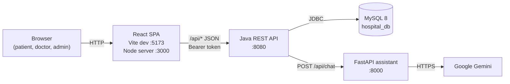

# Haven Hospital Management System

A complete hospital management application for a small hospital: a public information site, a staff
portal for administrators and doctors, real MySQL persistence, server-enforced authentication and an
optional AI assistant for visitors.

The project is split into three runnable services — a React frontend, a dependency-free Java REST API
and a Python/FastAPI assistant — plus a MySQL database. It was built as a software engineering course
project and is documented so that another developer can clone it and run everything locally.

---

## Table of contents

1. [Objectives](#objectives)
2. [Main features](#main-features)
3. [Technology stack](#technology-stack)
4. [Application architecture](#application-architecture)
5. [Repository structure](#repository-structure)
6. [Prerequisites](#prerequisites)
7. [Complete setup guide](#complete-setup-guide)
8. [Environment configuration](#environment-configuration)
9. [Database setup](#database-setup)
10. [How to run the whole application](#how-to-run-the-whole-application)
11. [URLs and ports](#urls-and-ports)
12. [Development accounts and login](#development-accounts-and-login)
13. [API overview](#api-overview)
14. [Authentication and user roles](#authentication-and-user-roles)
15. [Testing instructions](#testing-instructions)
16. [Troubleshooting](#troubleshooting)
17. [Security notes](#security-notes)
18. [Screenshots](#screenshots)
19. [Contributors](#contributors)

---

## Objectives

- Give patients and visitors accurate hospital information (location, hours, departments, emergency
  number) without creating an account.
- Let doctors run their working day: their patients, appointments and consultation notes.
- Let administrators manage doctors, patient records, staff accounts and hospital details.
- Keep medical data private through real authentication, server-side role checks and doctor-scoped
  queries — a doctor can only reach their own patients.
- Stay easy to install, understand and extend: no build framework on the backend, one lockfile on the
  frontend and a documented database migration path.

## Main features

**Public website**

- Hospital homepage with address, emergency number, reception contact, visiting hours, visitor limit
  and parking details, all editable by the administrator and stored in MySQL, plus the department list
  and an appointment walkthrough.
- Optional "Ask about visiting" assistant, answered by Gemini through the Java API (the key never
  reaches the browser).

**Authentication and accounts**

- Email/password sign-in for two roles: `ADMIN` and `DOCTOR`.
- PBKDF2-HMAC-SHA256 password hashes, opaque session tokens stored hashed, 12-hour sessions, logout,
  revocation on password change and deactivation, and failed-login throttling.
- Administrators create staff accounts, reset passwords and deactivate/activate accounts.

**Administrator dashboard**

- Totals for doctors, patients, appointments and consultations, plus a recent-activity feed.
- Doctor management: search, filter by status, create with a login, edit, mark on leave, deactivate
  (records are kept), reactivate.
- Patient management: register, edit, assign to a doctor, see appointment and consultation counts.
- Account management: list, create administrator or doctor accounts, activate/deactivate, reset
  passwords. The last active administrator and your own account are protected.
- Hospital settings: name, contacts, address, parking, visiting hours, visitor limit and your own
  profile.

**Doctor dashboard**

- Today view: today's appointments, next patient, week strip, "mark as seen".
- Appointments: search, book for an assigned patient, reschedule, cancel, change status.
- Consultations: record diagnosis, treatment and notes on completed appointments, edit them, and read
  a patient's earlier notes.
- Profile: name, phone, office, email, working days, working hours, visit length and password change.

## Technology stack

| Layer | Technology | Version used |
| --- | --- | --- |
| Frontend | React, React Router, Vite, Tailwind CSS 4, Motion | React 19, Router 7, Vite 8 |
| Backend | Java (JDK `com.sun.net.httpserver`), Gson 2.13.2, MySQL Connector/J 26.7.0 | compiled with JDK 27, targets Java 17 |
| Database | MySQL 8 (InnoDB, utf8mb4, foreign keys) | 8.0.46 |
| AI service | Python, FastAPI, Google GenAI SDK (Gemini) | Python 3.10, FastAPI 0.115+ |
| Tooling | npm, javac, pip/venv, Git | npm 11, Node 26.13 (verified) |

The backend intentionally has no Maven/Gradle build: it compiles with `javac` against the two jars in
`backend/lib/`. The code is still layered (routes → DAOs → MySQL), so it can be moved to a framework
later without changing the frontend contract.

## Application architecture



- The browser only ever calls the frontend origin. In development Vite proxies `/api` to the Java API;
  in production `frontend/server.js` does the same.
- The API owns authentication, authorization and every SQL statement.
- The AI key lives only in `backend_ai/.env`; the Java service proxies questions to it.
- A rendered version of the original diagram is kept at
  [`docs/images/architecture-diagram.png`](docs/images/architecture-diagram.png).

Deeper material — request lifecycle, data model, design decisions — is in
[`docs/architecture.md`](docs/architecture.md).

## Repository structure

```text
GL-Project/
├── README.md                     this guide
├── .gitignore                    secrets, build output, tools
├── docs/
│   ├── architecture.md           components, flows, data model
│   ├── api-documentation.md      endpoint reference
│   ├── setup-guide.md            detailed developer setup
│   └── images/                   architecture diagram
├── frontend/                     React + Vite single-page app
│   ├── README.md
│   ├── package.json / package-lock.json
│   ├── index.html
│   ├── public/favicon.svg
│   ├── server.js                 production static server + /api proxy
│   ├── vite.config.js
│   └── src/
│       ├── admin/                dashboard layout, overview, doctors, patients, accounts, settings
│       ├── doctor/               layout, today, appointments, consultations, profile
│       ├── components/           UI kit, shell, modals, toasts, route guard, assistant
│       ├── pages/                public Visit Us page, staff login
│       ├── services/             API client, auth, hospital settings
│       ├── hooks/                ripple effect, count-up animation
│       ├── config/               fallback hospital details and departments
│       └── utils/                date helpers
├── backend/                      Java REST API
│   ├── README.md
│   ├── .env.example
│   ├── build.sh / build.bat
│   ├── run.sh / run.bat
│   ├── lib/                      gson-2.13.2.jar, mysql-connector-j-26.7.0.jar
│   └── src/
│       ├── Main.java             entry point: migrate, then start
│       ├── api/                  HTTP routing, JSON, validation, CORS, AI client
│       ├── config/               configuration, connection, schema migration
│       ├── dao/                  SQL for users, doctors, patients, appointments, ...
│       ├── model/                data objects
│       ├── security/             password hashing, sessions, login throttling
│       └── tool/                 DbSetup and SetPassword command-line helpers
├── backend_ai/                   FastAPI + Gemini service
│   ├── README.md
│   ├── .env.example
│   ├── main.py
│   ├── requirements.txt
│   ├── requirements-rag.txt
│   ├── test_models.py            one-call Gemini smoke test
│   └── experiments               hospital_data / Pinecone upload scripts (optional)
├── database/
│   ├── README.md
│   ├── hospital_db.sql           original dump — DESTRUCTIVE, read the warning
│   ├── schema.sql                reference schema (safe, no data loss)
│   └── migrations/README.md      how schema upgrades are applied
└── tests/
    ├── api_test.py               end-to-end API and authorization checks
    └── java/PasswordHasherTest.java
```

## Prerequisites

| Tool | Required | Verified on | Check command |
| --- | --- | --- | --- |
| JDK | 17 or newer | JDK 27 (`--release 17` build passes) | `java -version` |
| MySQL Server | 8.0 or newer | 8.0.46 | `mysql --version` |
| Node.js + npm | Node 20.19+ or 22.12+ (Vite 8 requirement); LTS 22 recommended | Node 26.13.1, npm 11 | `node -v`, `npm -v` |
| Python | 3.10+ **64-bit** (for the optional AI service; 32-bit cannot install Gemini's dependencies) | 3.15.0 64-bit | `python --version` |
| Git | any recent version | — | `git --version` |

The application runs without Python/the AI service; the assistant then shows a clear "offline"
message. MySQL and the JDK are required.

## Complete setup guide

Every step lists the directory, the command, the expected result and the usual errors. Commands are
written for **Windows** (Command Prompt or PowerShell); Linux/macOS equivalents are noted where they
differ. Detailed explanations live in [`docs/setup-guide.md`](docs/setup-guide.md).

### Step 1 — Install the prerequisites

```bat
java -version
javac -version
mysql --version
node -v
npm -v
```

Expected: Java 17+, a `javac` of the same version, MySQL 8.x, Node 20.19+ (or 22.12+) and npm 9+.

- *`'java' is not recognized`* → install a JDK and add its `bin` folder to `PATH`.
- *`'npm' is not recognized`* → install Node.js LTS from <https://nodejs.org> and reopen the terminal.

### Step 2 — Clone the repository

```bat
git clone https://github.com/bilelsoussi2k24/GL-Project.git
cd GL-Project
```

Expected: the folders `frontend`, `backend`, `backend_ai`, `database`, `docs` and `tests`.

### Step 3 — Configure the MySQL database

Start MySQL, then create the database (the API also does this automatically when its user is allowed
to create databases):

```bat
mysql -u root -p -e "CREATE DATABASE IF NOT EXISTS hospital_db CHARACTER SET utf8mb4 COLLATE utf8mb4_0900_ai_ci;"
```

Expected: no output, and `SHOW DATABASES;` lists `hospital_db`.

> **Do not import `database/hospital_db.sql` into an existing database.** That legacy dump starts with
> `DROP TABLE` statements and would erase data. See [Database setup](#database-setup) and
> [`database/README.md`](database/README.md) for the safe procedures.

- *`Access denied for user 'root'`* → use the MySQL account and password you actually installed.
- *Unknown database* later at startup → your MySQL user cannot create schemas; create it manually as
  above.

### Step 4 — Configure environment variables

```bat
cd backend
copy .env.example .env
```

Open `backend/.env` and set at least:

```ini
DB_USER=root
DB_PASSWORD=your-mysql-password
ADMIN_EMAIL=admin@haven.local
ADMIN_PASSWORD=choose-a-development-password
```

Expected: `backend/.env` exists and is listed as ignored by `git status` (it must never be committed).

- *The API starts but `/api/health` says `database: unavailable`* → wrong `DB_USER`/`DB_PASSWORD`.
- *No administrator can sign in* → `ADMIN_PASSWORD` was empty on the very first start; the generated
  password was printed once in the console. Reset it with `tool.SetPassword` (see
  [Development accounts](#development-accounts-and-login)).

### Step 5 — Install frontend dependencies

```bat
cd ..\frontend
npm ci
```

`npm ci` installs exactly the versions in `package-lock.json`; use `npm install` only when you
intentionally change dependencies.

Expected: a `node_modules` folder and no errors.

- *`EBADENGINE` or "Vite requires Node.js version 20.19+"* → upgrade Node.
- *Proxy/network errors* → configure npm's proxy or retry; the lockfile is committed.

### Step 6 — Start the Java backend

```bat
cd ..\backend
build.bat
run.bat
```

If your shell reports that `build.bat` is not recognized, run `.\build.bat` and `.\run.bat`.

Expected output:

```text
Database 'hospital_db' is ready.
Haven Hospital API listening on http://127.0.0.1:8080
Allowed browser origins: http://localhost:5173, ...
```

On the first start it also creates the schema and the first administrator (its password is the
`ADMIN_PASSWORD` you set, or a random one printed once).

Check it in a second terminal:

```bat
curl http://localhost:8080/api/health
```

Expected: `{"status":"ok","database":"ok (MySQL 8.0.46)","time":"..."}`.

- *`ClassNotFoundException: Main`* → in Git Bash use `MSYS_NO_PATHCONV=1 java -cp "out;lib/*" Main`
  (Windows classpath separator `;`, and Git Bash must not rewrite it).
- *`Address already in use`* → another process owns port 8080; change `PORT` in `backend/.env` and the
  Vite proxy target, or stop the other process.
- *`Public Key Retrieval is not allowed`* → keep `allowPublicKeyRetrieval=true` in `DB_URL` (the
  default adds it when the URL has no query string).

Linux/macOS/Git Bash: `./build.sh` and `./run.sh` instead of the `.bat` files.

### Step 7 — Start the React frontend

In a new terminal, from the repository root:

```bat
cd frontend
npm run dev
```

Expected:

```text
VITE v8.x  ready in ... ms
➜  Local:   http://localhost:5173/
```

Open <http://localhost:5173>. Vite forwards `/api` to `http://localhost:8080`, so the backend must be
running. Sign in with the administrator account from Step 4.

- *"Cannot reach the server"* in the UI → the backend is not running or listens on another port.
- *Blank page after pulling changes* → stop Vite, `npm ci`, start again.

### Step 8 — Start the Python AI service (optional)

```bat
cd ..\backend_ai
python -m venv venv
venv\Scripts\activate
pip install -r requirements.txt
copy .env.example .env
```

Put a Gemini key in `backend_ai/.env` (`GEMINI_API_KEY=...`, created at
<https://aistudio.google.com/apikey>), then:

```bat
uvicorn main:app --reload --port 8000
```

Expected: `Uvicorn running on http://127.0.0.1:8000`. Check `http://127.0.0.1:8000/api/health` →
`{"status":"ok","configured":true,"model":"gemini-2.5-flash"}`.

Linux/macOS: `source venv/bin/activate` and the same `pip`/`uvicorn` commands.

Without a key the service still starts, reports `configured: false` and answers 503; the public page
then shows "The hospital assistant is offline".

- *`ModuleNotFoundError: fastapi`* → the virtual environment is not activated.
- *502 from the assistant* → Gemini rejected the call (invalid key, quota, model name). The Python
  console prints the reason.

### Step 9 — Verify that all services communicate

1. `GET http://localhost:8080/api/health` reports `database: ok`.
2. <http://localhost:5173> shows the hospital details from MySQL.
3. Administrator sign-in lands on `/admin` with real totals.
4. Create a doctor in **Doctors**, sign out, sign in as that doctor → `/doctor` shows their workspace.
5. Book an appointment and mark it as seen; the data survives a page refresh.
6. With the AI key configured, ask a question in "Ask about visiting" and receive an answer.

A full checklist, including role-isolation checks, is in
[Testing instructions](#testing-instructions).

## Environment configuration

Configuration is read from real environment variables first, then from a `.env` file. Only the
`.example` templates are committed.

### `backend/.env`

| Variable | Default | Meaning |
| --- | --- | --- |
| `DB_URL` | `jdbc:mysql://localhost:3306/hospital_db` | JDBC URL; connection flags are appended when absent |
| `DB_USER` | `root` | MySQL user |
| `DB_PASSWORD` | *(empty)* | MySQL password |
| `BIND_ADDRESS` | `127.0.0.1` | Interface the API listens on |
| `PORT` | `8080` | API port (`0`/invalid falls back to 8080) |
| `CORS_ORIGINS` | `http://localhost:5173,http://127.0.0.1:5173,http://localhost:3000,http://127.0.0.1:3000` | Browser origins allowed to call the API |
| `SESSION_HOURS` | `12` | Staff session lifetime |
| `ADMIN_EMAIL` | `admin@haven.local` | First administrator email |
| `ADMIN_PASSWORD` | *(random, printed once)* | First administrator password |
| `AI_SERVICE_URL` | `http://127.0.0.1:8000/api/chat` | Python assistant endpoint |
| `AI_TIMEOUT_SECONDS` | `25` | AI request timeout |
| `AUTO_MIGRATE` | `true` | Apply the add-only schema migration on start |

### `backend_ai/.env`

| Variable | Default | Meaning |
| --- | --- | --- |
| `GEMINI_API_KEY` | *(required for answers)* | Google AI Studio key |
| `GEMINI_MODEL` | `gemini-2.5-flash` | Model name |
| `GEMINI_TIMEOUT_MS` | `20000` | Gemini call timeout |
| `AI_CORS_ORIGINS` | `http://localhost:5173,...` | Origins allowed to call the service directly |
| `PINECONE_API_KEY` | *(optional)* | Only for the experimental RAG scripts |
| `PINECONE_INDEX_NAME` | `hospital-embeddings` | Only for the experimental RAG scripts |

### Frontend

The React app needs no secrets and no `.env` file in development: it calls `/api` on its own origin,
which Vite (dev) and `server.js` (production) proxy to the Java API.

| Variable | Used by | Default | Meaning |
| --- | --- | --- | --- |
| `PORT` | `frontend/server.js` | `3000` | Port of the production static server |
| `API_URL` | `frontend/server.js` | `http://localhost:8080` | Java API origin to proxy `/api` to |

Example production start on another backend:

```bat
set API_URL=http://127.0.0.1:9090
set PORT=3000
npm start
```

## Database setup

The Java API creates the database (when permitted), all tables, indexes and the first administrator on
first start. Normally that is all you need.

- **Fresh database:** create `hospital_db` (Step 3) or let the API create it, then start the API.
- **Existing database from the original project:** do **not** re-import the dump. Start the API; the
  additive migration adds the missing tables/columns, assigns staff IDs (`DR-0001`, …) and creates an
  administrator. Existing records are preserved.
- **Reference schema:** [`database/schema.sql`](database/schema.sql) documents the current tables. It
  only uses `CREATE TABLE IF NOT EXISTS` and `INSERT IGNORE`.
- **Legacy dump:** [`database/hospital_db.sql`](database/hospital_db.sql) is the original MySQL dump.
  It contains six `DROP TABLE IF EXISTS` statements, so importing it into a database that already has
  data destroys that data. Import it only into an empty database, or use a backup first.

Backup and restore, table descriptions and the destructive-import warning are detailed in
[`database/README.md`](database/README.md).

## How to run the whole application

Four terminals (or three if you skip the assistant), started in this order:

```bat
:: 1. Java API — http://localhost:8080
cd backend
run.bat

:: 2. React frontend — http://localhost:5173
cd frontend
npm run dev

:: 3. AI assistant — http://localhost:8000 (optional)
cd backend_ai
venv\Scripts\activate
uvicorn main:app --port 8000
```

MySQL runs as a service in the background (start it from Services or `net start mysql` if needed).

Production-style frontend (serves the built app on port 3000 and proxies `/api`):

```bat
cd frontend
npm run build
npm start
```

## URLs and ports

| Service | URL | Port | Notes |
| --- | --- | --- | --- |
| Public website | <http://localhost:5173> | 5173 | Vite development server |
| Staff login | <http://localhost:5173/login> | 5173 | Admin or doctor |
| Administrator dashboard | <http://localhost:5173/admin> | 5173 | Requires an `ADMIN` session |
| Doctor dashboard | <http://localhost:5173/doctor> | 5173 | Requires a `DOCTOR` session |
| Production frontend | <http://localhost:3000> | 3000 | `npm run build` + `npm start` |
| Java API | <http://localhost:8080/api> | 8080 | JSON; `/api/health` is public |
| AI service | <http://localhost:8000/api> | 8000 | `/api/health`, `/api/chat` |
| MySQL | `localhost:3306` | 3306 | Database `hospital_db` |

## Development accounts and login

Accounts live in MySQL and passwords are stored only as PBKDF2 hashes. **No password is committed to
this repository**, and the application does not silently create demo accounts in production.

| Role | Full name | Login identifier | Password | Access |
| --- | --- | --- | --- | --- |
| Admin | `Administrator` (editable in Settings) | `admin@haven.local` — the `ADMIN_EMAIL` value from `backend/.env` | Set through the development seed process: the `ADMIN_PASSWORD` you configure before the first start. If it is empty, a random password is generated and printed once in the backend console. Change it after signing in. | `/admin` — doctors, patients, accounts, settings |
| Doctor | The name you enter, for example `Dr. Amine Khelif` | The email you enter in **Doctors → Add doctor** (nothing is pre-seeded on a fresh database). In a database upgraded from the legacy dump, `ahmed@hospital.com` and `sara@hospital.com` exist but their placeholder hashes do not work until a password is reset. | Set through the development seed process: typed when the administrator creates the doctor (minimum 8 characters, at least one letter and one digit), or reset later from **Accounts → Reset password**. | `/doctor` — today, appointments, profile |

### Creating or resetting an administrator

- **First administrator:** set `ADMIN_EMAIL` and `ADMIN_PASSWORD` in `backend/.env` before the first
  start. The API creates it only when no administrator with a usable hash exists.
- **Additional administrator:** sign in as an administrator → **Accounts → Add account**, choose
  `Administrator`. The last active administrator cannot be deactivated.
- **Forgot the password / locked out:** from `backend/` run
  `java -cp "out;lib/*" tool.SetPassword admin@haven.local "NewPassword123"`. This revokes that
  account's sessions. Alternatively, another administrator can reset it in **Accounts**.
- **Existing deployment with placeholder hashes:** `java -cp "out;lib/*" tool.DbSetup` lists the
  affected accounts; reset them as above.

### Creating or resetting a doctor

- **Create:** sign in as an administrator → **Doctors → Add doctor**, then enter name, specialty,
  email and an initial password (or **Accounts → Add account** with role `Doctor`). The doctor can
  sign in immediately and change their password in **Profile**.
- **Reset:** **Accounts → Reset password** (requires an active administrator).
- **Remove access:** **Doctors → Deactivate** (or **Accounts → Deactivate**). The account can no
  longer sign in and its sessions are revoked; patients, appointments and consultations are kept, and
  the doctor can be reactivated later.

> These accounts are for **local development only**. Anyone who can read this README knows the
> default administrator email, so set a unique `ADMIN_PASSWORD`, and never reuse production
> credentials here. See [Security notes](#security-notes) before exposing the API publicly.

## API overview

Base URL: `http://localhost:8080/api`. All bodies are JSON; errors are `{"error": "message"}` with a
meaningful status code. Protected routes need `Authorization: Bearer <token>`.

| Method | Path | Access | Purpose |
| --- | --- | --- | --- |
| GET | `/health` | public | API and database status |
| GET | `/public/hospital` | public | Hospital details for the public site |
| POST | `/assistant/chat` | public, throttled | Ask the AI assistant (proxied server-side) |
| POST | `/auth/login` | public | Sign in (`email`, `password`, optional `role`) |
| POST | `/auth/logout` | staff | Revoke the current session |
| GET | `/auth/me` | staff | Current account and doctor profile |
| PATCH | `/auth/account` | staff | Update own name/email |
| POST | `/auth/password` | staff | Change own password |
| GET / PATCH | `/doctors/me` | doctor | Own profile and working hours |
| GET | `/doctors/me/patients` | doctor | Assigned patients (`q` search) |
| GET | `/doctors/me/patients/{id}` | doctor | One assigned patient |
| GET | `/doctors/me/patients/{id}/consultations` | doctor | That patient's consultation history |
| GET / POST | `/doctors/me/appointments` | doctor | List (`from`, `to`, `status`) / book |
| PUT | `/doctors/me/appointments/{id}` | doctor | Reschedule / change patient |
| PATCH | `/doctors/me/appointments/{id}/status` | doctor | `scheduled`, `completed`, `cancelled`, `missed` |
| GET / POST | `/doctors/me/consultations` | doctor | List / create notes |
| PUT | `/doctors/me/consultations/{id}` | doctor | Update notes |
| GET | `/admin/stats` | admin | Dashboard totals |
| GET | `/admin/activity` | admin | Recent appointments, consultations, accounts |
| GET / POST | `/admin/doctors` | admin | List (`q`, `status`) / create with account |
| GET / PUT / DELETE | `/admin/doctors/{id}` | admin | Detail / update / deactivate |
| PATCH | `/admin/doctors/{id}/status` | admin | `active`, `leave`, `inactive` |
| GET / POST | `/admin/users` | admin | List (`q`, `role`) / create account |
| PATCH | `/admin/users/{id}/active` | admin | Activate / deactivate |
| POST | `/admin/users/{id}/password` | admin | Reset password and revoke sessions |
| GET / POST | `/admin/patients` | admin | List (`q`) / register |
| PUT | `/admin/patients/{id}` | admin | Update demographics |
| PUT | `/admin/patients/{id}/doctor` | admin | Assign to a doctor |
| GET | `/admin/appointments` | admin | Recent appointments (`limit`) |
| GET | `/admin/consultations` | admin | Recent consultations (`limit`) |
| GET / PUT | `/admin/settings` | admin | Read / update hospital details |

Request and response examples for every endpoint: [`docs/api-documentation.md`](docs/api-documentation.md).

## Authentication and user roles

| Role | Can do | Cannot do |
| --- | --- | --- |
| `ADMIN` | Manage doctors, patients, staff accounts, hospital settings; read stats and activity | Open the doctor workspace; read consultation notes through doctor routes |
| `DOCTOR` | Read/update own profile, read only assigned patients, manage own appointments and consultations | Any `/admin/*` route (403), another doctor's patient/appointment/consultation (404) |

- Passwords: PBKDF2-HMAC-SHA256, 210 000 iterations, per-password salt. Minimum 8 characters with a
  letter and a digit.
- Sessions: random 32-byte token returned once; the database stores only its SHA-256 hash, with an
  expiry. Logout, password change and deactivation revoke sessions.
- Throttling: more than 8 failed logins for the same email and client within 10 minutes → 429.
- The frontend route guard is only a convenience; every protected route re-checks the token and role
  on the server.

## Testing instructions

Start the backend against a database you can safely write to, then run the checks.

### API integration tests

```bat
python tests\api_test.py
```

Optional environment variables: `API_BASE` (default `http://127.0.0.1:8080/api`), `ADMIN_EMAIL`,
`ADMIN_PASSWORD`. The script creates uniquely named doctors and a patient, so it can run repeatedly
against the same database. It covers:

- health, login, wrong password, role mismatch, missing or expired token;
- doctor creation, validation, duplicate email, search and status changes;
- patient assignment and doctor scoping, cross-doctor 404s;
- appointment booking/rescheduling/status, consultation creation, duplicate prevention and history;
- hospital settings validation and public reflection; AI gateway behaviour;
- password change and session revocation, deactivation/reactivation, account administration, stats.

### Unit checks for password and token hashing

```bat
javac -encoding UTF-8 -d .tmp\test-classes -cp "backend\out" tests\java\PasswordHasherTest.java
java -cp ".tmp\test-classes;backend\out" PasswordHasherTest
```

Covers hash format, correct/incorrect passwords, per-password salt, malformed and legacy hashes, the
strength rule and SHA-256 token hashing.

### Frontend checks

```bat
cd frontend
npm run lint
npm run build
```

`oxlint` reports 0 errors; it currently emits 4 informational `react(set-state-in-effect)` hints in
data-loading effects. The build produces `frontend/dist/`.

### Manual acceptance checklist

1. `/api/health` reports `database: ok`.
2. The public page shows the values saved in the administrator's Settings.
3. Administrator sign-in shows real totals and recent activity.
4. Create a doctor, sign in as them, book an appointment, mark it seen, save consultation notes.
5. Refresh the page: the appointment and notes are still there.
6. While signed in as the doctor, open `/admin` → redirected; call `/api/admin/stats` directly → 403.
7. Deactivate the doctor → they can no longer sign in or use an existing token; reactivate them.
8. Edit hospital details → the public page reflects them.

### Results of the verification run for this version

| Check | Result |
| --- | --- |
| Backend compilation (`javac`, also `--release 17`) | passes |
| `tests/api_test.py` against MySQL 8.0.46 | 84/84 checks pass, twice in a row |
| Legacy dump migration + data preservation | 23/23 checks pass |
| `PasswordHasherTest` | all checks pass |
| `npm run build` | passes |
| `npm run lint` | 0 errors, 4 informational hints |
| Production server (`npm start`) | `/`, `/doctor`, assets, `/api` proxy and 404 all behave |
| Browser flow | admin and doctor dashboards, booking, "mark as seen", consultation notes, public page, logout |
| AI service startup | dependencies install in a clean virtual environment; `/api/health` answers `configured: false`; the Java proxy returns 503 "not configured yet" |
| AI answer with a live Gemini key | **not run here** (no key available) |

## Troubleshooting

| Symptom | Cause and fix |
| --- | --- |
| `Cannot reach the server` | Backend not running on 8080. Start it and check `/api/health`. |
| `database: unavailable: Access denied` | Wrong `DB_USER`/`DB_PASSWORD` in `backend/.env`, or that MySQL user lacks access. |
| `Unknown database 'hospital_db'` | The MySQL user cannot create schemas. Create it manually (Step 3) and restart the API. |
| `Public Key Retrieval is not allowed` | Use the default `DB_URL` (it appends `allowPublicKeyRetrieval=true`) or add the flag yourself. |
| `ClassNotFoundException: Main` | Wrong classpath separator. Windows: `"out;lib/*"`. Git Bash: prefix the command with `MSYS_NO_PATHCONV=1`. |
| `Address already in use` | Port 8080 or 5173 is taken. Change `PORT`/the Vite proxy target, or stop the other process. |
| Doctor account cannot sign in after importing the legacy dump | Placeholder hashes. Reset the password from **Accounts** or with `tool.SetPassword`. |
| `Incorrect email or password` | Accounts are case-insensitive on email; check the account exists in **Accounts** and is active. |
| 429 on sign-in | Too many failed attempts; wait 10 minutes or restart the API (the throttle is in memory). |
| 401 after a while | Session expired (`SESSION_HOURS`); sign in again. |
| Assistant always offline (503) | `backend_ai` is not running, `GEMINI_API_KEY` is unset, or `AI_SERVICE_URL` points elsewhere. |
| Assistant 502 | Gemini rejected the call (quota, model, network); the Python console prints the reason. |
| `npm run dev` fails with an engine error | Node is older than 20.19. Upgrade Node. |
| `pip install -r requirements.txt` fails building `cryptography` / `maturin` | The Python interpreter is 32-bit. Install 64-bit Python 3.10+ and recreate the virtual environment. |
| `No build found. Run "npm run build" first` | `npm start` serves `dist/`; build first. |
| Frontend shows an old version | Restart Vite, or rebuild with `npm run build`. |

## Security notes

- Real secrets are never committed: only `.env.example` templates with placeholders. `.env`, build
  output, virtual environments, logs and local tooling are ignored by Git.
- Passwords are salted and slowly hashed (PBKDF2); sessions are stored only as hashes. Nothing usable
  can be replayed from a database dump.
- Every query uses prepared statements, and doctor-owned rows include the doctor id in SQL.
- CORS is an explicit allowlist; the API sends `Cache-Control: no-store` on responses.
- The Gemini key stays in the Python service; the browser only talks to the Java API, which rate limits
  the public assistant (15 questions per minute per client).
- No demo doctor accounts are created automatically. The only bootstrap account is the configured
  administrator, and it is created only when the database has none; everything else is created
  deliberately by an administrator. If `ADMIN_PASSWORD` is not set, a random one is generated and
  printed once rather than a predictable default.
- Before exposing this application outside a development machine:
  1. Change every development password and use a dedicated MySQL user with only the needed
     privileges.
  2. Put the API behind HTTPS (a reverse proxy), set `BIND_ADDRESS` accordingly and restrict
     `CORS_ORIGINS` to your real origin.
  3. Keep `backend/.env` and `backend_ai/.env` out of version control and out of backups you share.
  4. Consider clearing the in-memory throttle by running a single instance or moving it to a shared
     store if you scale horizontally.

## Screenshots

The architecture diagram is available at
[`docs/images/architecture-diagram.png`](docs/images/architecture-diagram.png). UI screenshots are not
committed in this version; add them under `docs/images/` if you want them in the README.

## Project documentation

| Document | Contents |
| --- | --- |
| [`docs/setup-guide.md`](docs/setup-guide.md) | Long-form setup with checks, expected output and fixes |
| [`docs/architecture.md`](docs/architecture.md) | Components, request flows, data model, decisions |
| [`docs/api-documentation.md`](docs/api-documentation.md) | Endpoint reference with payload examples |
| [`frontend/README.md`](frontend/README.md) | Frontend stack, structure, pages, build and API wiring |
| [`backend/README.md`](backend/README.md) | Backend architecture, compilation, configuration, tools |
| [`backend_ai/README.md`](backend_ai/README.md) | AI service setup, endpoints, safety and troubleshooting |
| [`database/README.md`](database/README.md) | MySQL setup, tables, migrations, backup and restore |

## Contributors

Recorded in the repository's Git history:

- Khaireddine Ladhari
- nyx2nite
- bilelsoussi2k24

Contributions are welcome through pull requests; do not force-push or rewrite existing history.
