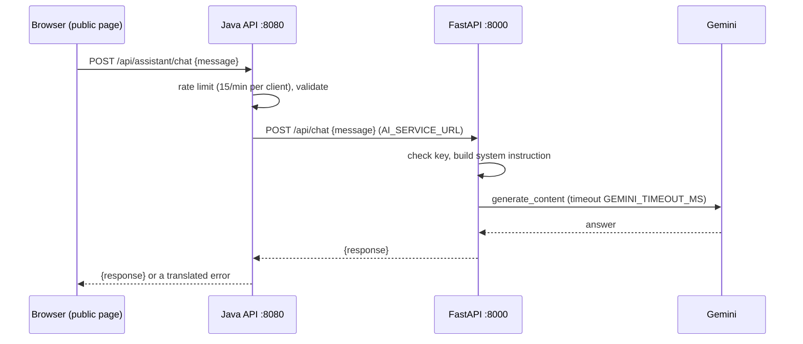

# Haven Hospital — AI assistant service

A small FastAPI service that answers **public, non-medical** questions about the hospital using Google
Gemini. The Java API proxies visitor questions here, so the Gemini key stays on the server and the
browser never calls Gemini directly.

It has no access to patient records, does not diagnose and does not recommend treatment. For urgent
questions it directs people to emergency services.

## Requirements

| Item | Version |
| --- | --- |
| Python | 3.10 or newer, **64-bit** (verified on 3.15.0 64-bit; a 32-bit interpreter cannot install the `cryptography` wheel that Gemini's dependencies need) |
| pip | any recent version |
| Network | HTTPS access to `generativelanguage.googleapis.com` |
| Gemini API key | free tier is enough for development (<https://aistudio.google.com/apikey>) |

The service is optional. Without it the rest of the application works; the public page shows "The
hospital assistant is offline".

## Setup

Windows:

```bat
cd backend_ai
python -m venv venv
venv\Scripts\activate
pip install -r requirements.txt
copy .env.example .env
```

Linux / macOS:

```bash
cd backend_ai
python3 -m venv venv
source venv/bin/activate
pip install -r requirements.txt
cp .env.example .env
```

Edit `.env` and add your key:

```ini
GEMINI_API_KEY=your-key-from-ai-studio
GEMINI_MODEL=gemini-2.5-flash
```

Never commit `.env`; it is ignored by Git (see `.gitignore`). Never put a key in `main.py` or in the
frontend.

## Run

```bat
uvicorn main:app --reload --port 8000
```

Without activating the environment:

```bat
venv\Scripts\python.exe -m uvicorn main:app --port 8000
```

Expected:

```text
INFO:     Uvicorn running on http://127.0.0.1:8000 (Press CTRL+C to quit)
INFO:     Application startup complete.
```

Health check:

```bash
curl http://127.0.0.1:8000/api/health
```

```json
{ "status": "ok", "configured": true, "model": "gemini-2.5-flash" }
```

`configured` is `false` when `GEMINI_API_KEY` is empty — the service still starts and answers 503.

## Endpoints

| Method | Path | Body | Success |
| --- | --- | --- | --- |
| GET | `/api/health` | — | `{ status, configured, model }` |
| POST | `/api/chat` | `{ "message": "..." }` | `{ "response": "..." }` |

Rules: `message` is required, 1–1000 characters, trimmed. Errors:

| Status | When |
| --- | --- |
| 400 | Message empty after trimming |
| 422 | Missing field, wrong type, or longer than 1000 characters (FastAPI validation) |
| 502 | Gemini error, blocked content, empty answer, network failure |
| 503 | `GEMINI_API_KEY` not configured |

Example:

```bash
curl -X POST http://127.0.0.1:8000/api/chat \
  -H "Content-Type: application/json" \
  -d '{"message":"When can I visit a patient?"}'
```

```json
{ "response": "Visiting hours are 10:00 to 19:00 every day, with up to 2 visitors per patient." }
```

## How it connects to the application



- The browser calls only the Java API; `AI_SERVICE_URL` (default `http://127.0.0.1:8000/api/chat`) is
  configured in `backend/.env`.
- Java maps failures to messages the UI can show: offline → 503, Gemini error → 502, timeout → 504,
  too many questions → 429.
- If you change the AI port, update `AI_SERVICE_URL` in `backend/.env`.
- Uvicorn serves HTTP/1.1; the Java client is pinned to HTTP/1.1 for this call, because its default
  HTTP/2 upgrade is rejected by Uvicorn (it shows up as a 422 in this log).

CORS (`AI_CORS_ORIGINS`) only matters if the service is called directly from a browser; the normal
path is server-to-server and needs no CORS.

## Configuration

| Variable | Default | Meaning |
| --- | --- | --- |
| `GEMINI_API_KEY` | — | Required for answers; empty → 503 |
| `GEMINI_MODEL` | `gemini-2.5-flash` | Model name; must exist for your key |
| `GEMINI_TIMEOUT_MS` | `20000` | Per-call timeout in milliseconds |
| `AI_CORS_ORIGINS` | localhost/127.0.0.1 on 5173 and 3000 | Comma-separated origins for direct browser calls |
| `PINECONE_API_KEY` | — | Only for the optional RAG scripts |
| `PINECONE_INDEX_NAME` | `hospital-embeddings` | Only for the optional RAG scripts |

## Safety behaviour

`SYSTEM_INSTRUCTION` in `main.py` restricts the assistant to visiting hours, departments, parking,
reception, appointments, facilities and emergencies. It must:

- never diagnose, interpret symptoms/results or recommend medication or treatment;
- direct urgent cases to emergency services;
- never claim access to patient records;
- say when a detail is unknown and suggest calling reception;
- answer in at most four sentences, in the language of the question.

The prompt reduces risk but is not a guarantee: treat answers as informational text, and keep the
emergency number visible on the page (it is).

## Testing

Smoke test with one real API call (needs a key):

```bat
python test_models.py
```

It prints the configured model, the answer, or the exact error. This is not part of the automated
suite because it spends quota.

Startup and error paths can be checked without a key:

```bat
curl http://127.0.0.1:8000/api/health
python -c "import fastapi, uvicorn, google.genai, dotenv; print('deps ok')"
```

Verified for this version: dependencies install in a clean virtual environment, Uvicorn starts, and
`/api/health` answers without a key. A live Gemini answer was **not** verified here because no key is
available in this environment.

## Experimental RAG scripts (optional)

These are standalone experiments; the chat endpoint does **not** use them.

| File | Purpose |
| --- | --- |
| `hospital_data.py` | Sample hospital sentences used as embeddings |
| `upload_knowledge.py` | Embeds those sentences and uploads them to a Pinecone index |
| `test_pinecone.py` | Prints the Pinecone indexes and the target index statistics |

To try them:

```bat
pip install -r requirements-rag.txt
set PINECONE_API_KEY=...
set PINECONE_INDEX_NAME=...
python test_pinecone.py
python upload_knowledge.py
```

`requirements-rag.txt` pulls `sentence-transformers`, which downloads a model (~90 MB) on first use.
They are intentionally excluded from the supported feature set.

## Troubleshooting

| Symptom | Cause / fix |
| --- | --- |
| `ModuleNotFoundError: fastapi` | Activate `venv` (or run `venv\Scripts\python.exe`). |
| `configured: false` | `GEMINI_API_KEY` empty or `.env` missing/not in `backend_ai/`. |
| 503 from the Java API | This service is not running, or `AI_SERVICE_URL` points to the wrong port. |
| 502 / "temporarily unavailable" | Invalid key, quota exhausted, wrong model name, network issue. The console prints `Gemini error: ...`. |
| 504 / "took too long" | Gemini exceeded `AI_TIMEOUT_SECONDS` (Java) or `GEMINI_TIMEOUT_MS` (this service). |
| 429 "Too many questions" | Java-side limit: 15 questions per minute per client. |
| `Address already in use` on 8000 | Another Uvicorn instance; stop it or use `--port 8001` and update `AI_SERVICE_URL`. |
| Answers ignore hospital facts | The model only receives the question and a general instruction; it does not read `hospital_settings`. Update the system instruction or add documents to the RAG experiment. |
