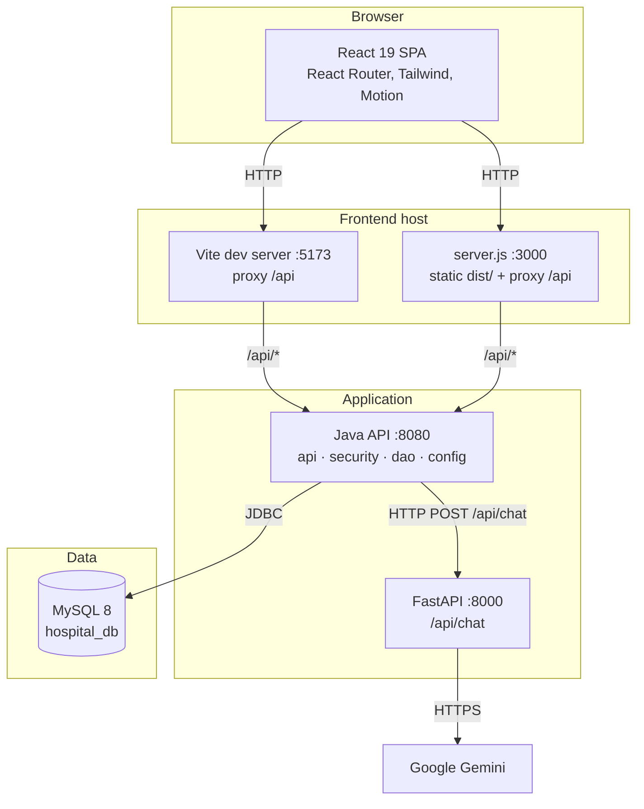
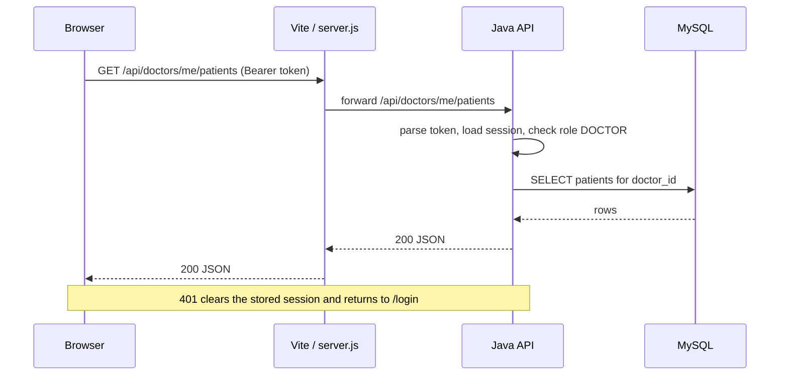
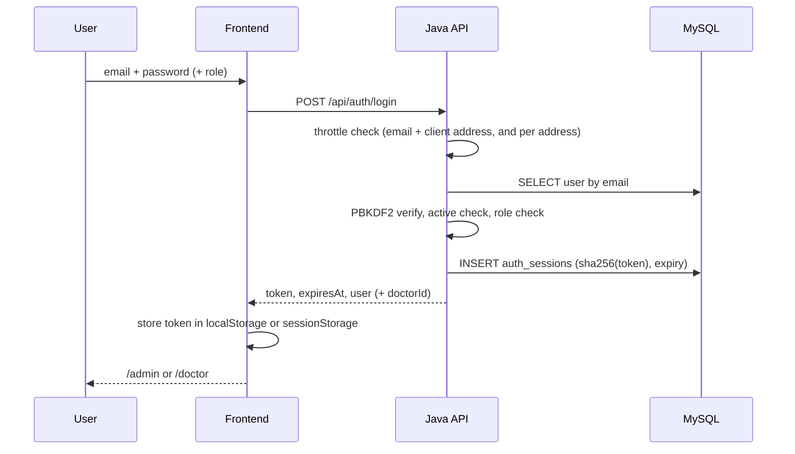
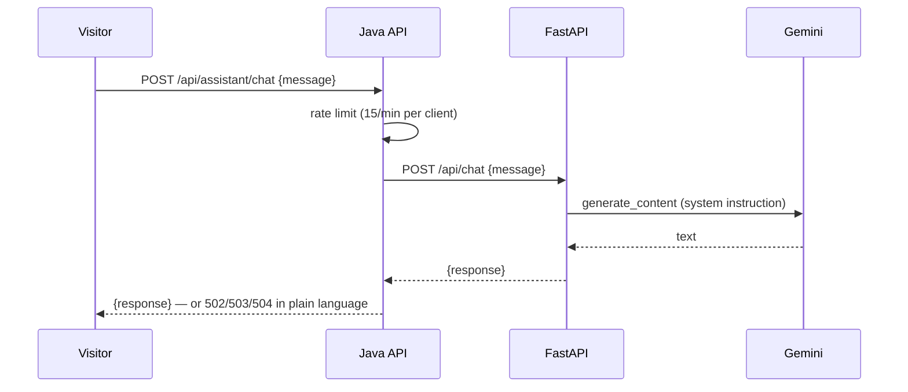
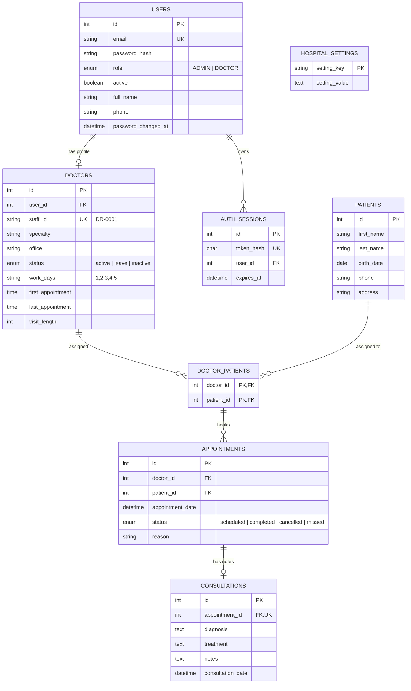

# Architecture

This document explains how the Haven Hospital Management System is put together, why the pieces are
separated the way they are, and what happens during the main request flows.

## Components



| Component | Responsibility | Does not |
| --- | --- | --- |
| React SPA | Rendering, form validation for usability, session storage, route guards | Enforce security, touch SQL, hold the AI key |
| Vite / `server.js` | Serve assets and proxy `/api` to the Java API | Contain business logic |
| Java API | Authentication, authorization, validation, all SQL, AI proxying | Render HTML |
| FastAPI service | One Gemini call per question, hospital-only system prompt | See patient data or the database |
| MySQL | Durable state and hashed credentials | — |

Keeping authorization and SQL in the Java service means the browser can be replaced (mobile app, CLI)
without weakening security.

## Backend layering

```text
Main
 └── config.DatabaseMigrator        ensure database, add missing schema, seed settings/admin
 └── api.HospitalServer             routes → access check → handler → Http response
      ├── api.CorsFilter            origin allowlist and preflight
      ├── api.Http                  body parsing, validation, JSON, query params
      ├── api.AssistantClient       server-side call to the Python service
      ├── security.AuthService      login, throttling, sessions, password change
      └── dao.*                     prepared SQL statements
           └── config.DatabaseConnection
```

- **Routes are declared once** in `HospitalServer.routes()`, each with an access level: `null`
  (public), `AUTH` (any staff), `ADMIN` or `DOCTOR`. The dispatcher resolves the bearer token, loads
  the session and checks the role before calling the handler, so a handler cannot forget the check.
- **DAO methods that return doctor-owned data take the doctor id** and put it in the `WHERE` clause.
  A doctor asking for someone else's patient receives "not found" without distinguishing it from a
  missing row.
- **Validation lives in `Http`** (lengths, email format, enums, ISO dates, weekday lists) and throws
  `ApiException` with the right status. Central exception handling in `dispatch` maps API errors,
  SQL constraint violations (409), connection failures (503) and unexpected errors (500).

## Request lifecycle

### Signed-in API call



### Sign-in



### AI question



## Data model



Design notes:

- `doctor_patients` is a composite-key join table **and** the pair is the foreign key used by
  appointments, so an appointment can only exist for an assigned patient. This single constraint
  enforces the "doctors only see their own patients" rule at the database level.
- `consultations.appointment_id` is unique: one set of notes per appointment. Creating a second one
  answers 409 instead of silently overwriting.
- `users` and `doctors` are separate because accounts can exist without a doctor profile
  (`ADMIN`), and deactivating a doctor must not delete medical history.
- `hospital_settings` is a key/value table so public page details can be edited without a migration.
- `auth_sessions` stores only a SHA-256 hash of the token; the raw token exists only in the browser.

## Database migration strategy

`config.DatabaseMigrator` runs on every start when `AUTO_MIGRATE=true` and is designed for databases
that already contain data:

1. `CREATE DATABASE IF NOT EXISTS` (when permitted).
2. `CREATE TABLE IF NOT EXISTS` for every table.
3. Add missing columns only (checked against `information_schema`), with defaults.
4. Widen `doctors.status` and `appointments.status` enums when values are missing.
5. Backfill `staff_id` for doctors that do not have one (`DR-0001`, `DR-0002`, …).
6. Add missing indexes.
7. `INSERT IGNORE` the default hospital settings.
8. Create the configured administrator only when no **active** administrator has a usable PBKDF2 hash;
   never reset a working administrator, never change a doctor's role or password; rename the
   legacy default title "Hospital Administrator" to "Administrator".

It never drops a table, a column or a row, and it never overwrites an existing profile or password.
Rollback is therefore a database restore, which is why backups are documented in
[`../database/README.md`](../database/README.md).

## Frontend architecture

- `services/api.js` is the only `fetch` caller. It adds the bearer token, parses JSON, converts HTTP
  errors into user-safe messages, and on 401 clears the session and emits `haven:unauthorized`, which
  `App.jsx` uses to return to `/login`.
- `services/auth.js` owns login/logout/account/password and the stored session (localStorage when
  "keep me signed in", otherwise sessionStorage).
- `admin/AdminData.jsx` and `doctor/DoctorData.jsx` are data providers: they load from the API, expose
  async actions, refresh after mutations and wrap the dashboard in a loading/error gate.
- `components/RequireRole.jsx` redirects unauthenticated or wrong-role visitors. It is usability only;
  the API repeats the check.
- UI primitives (`components/ui.jsx`), modals, toasts, search, empty states and the assistant live in
  `components/`; page-level composition lives in `admin/`, `doctor/` and `pages/`.

## Design decisions and trade-offs

| Decision | Why | Cost |
| --- | --- | --- |
| JDK HTTP server instead of Spring | No build tool or framework install; the project runs with `javac` + two jars | Manual routing, no built-in DI/validation |
| PBKDF2 from the JDK | No extra dependency; standard and slow enough for passwords | Not memory-hard like Argon2 |
| Opaque sessions in a table | Immediate revocation on logout/deactivation; no token forgery risk | One database lookup per request |
| Additive migration in Java | Existing dump upgraded in place without a migration framework | Schema lives in code, not in versioned SQL files |
| Vite proxy / Node proxy | Frontend and API share an origin; no CORS in normal use | The proxy must be running |
| AI behind the Java API | Key stays server-side; one place to rate limit and translate errors | One extra hop |
| Doctor data scoped in SQL | Authorization cannot be forgotten in a handler | Slightly more specific DAO signatures |

## Extending the system

- **New endpoint:** add a DAO method with the SQL, validate with `Http`, register the route with its
  role in `HospitalServer.routes()`, return a map/record.
- **New table:** add it to `createTables` and its columns to the migration helpers; never `ALTER`
  destructively.
- **New screen:** add it under `admin/` or `doctor/`, use the existing data provider, and keep
  `RequireRole` around the route group.
- **Swapping the AI provider:** change `backend_ai/main.py` only; the Java contract
  (`POST /api/chat` → `{"response": "..."}`) stays stable.
